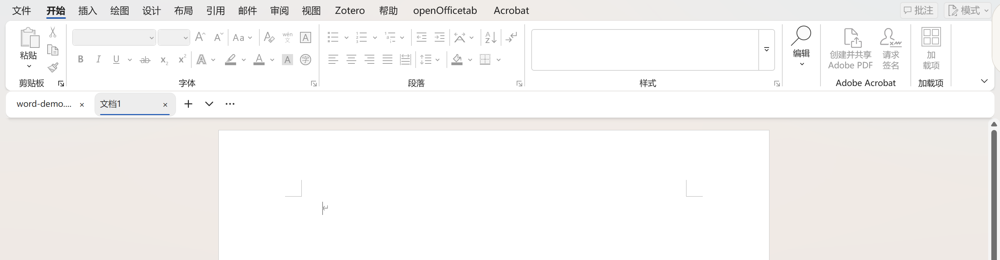
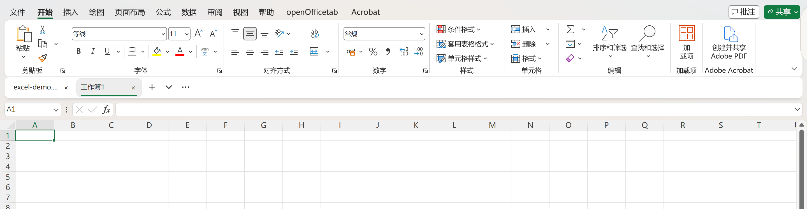
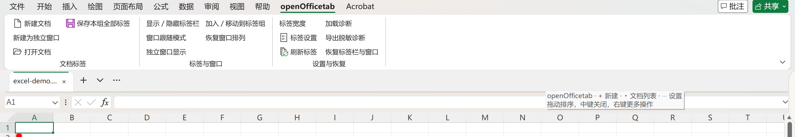
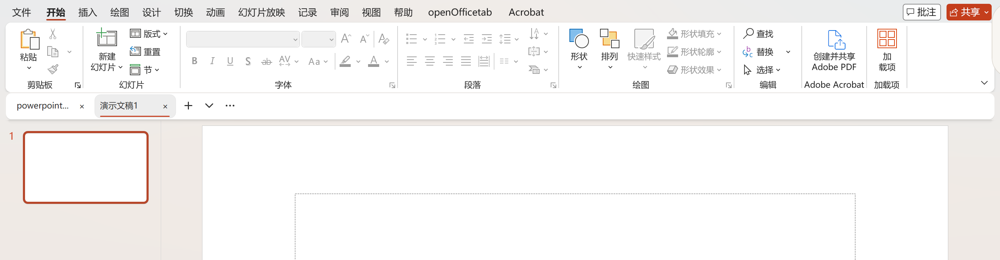
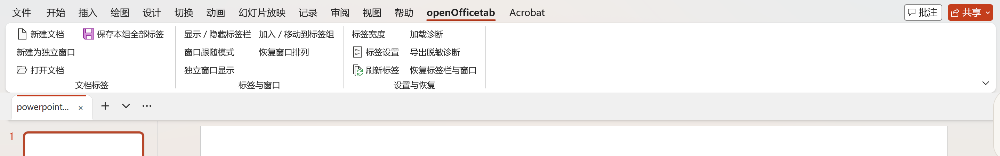

<div align="center">

# openOfficetab

**Browser-style document tabs for Word, Excel, and PowerPoint.**

Free · Open source · Native C++ · Windows desktop Office

[](LICENSE)
[](#compatibility)
[](https://github.com/xlennart/openOfficetab/actions/workflows/build.yml)
[](https://github.com/xlennart/openOfficetab/releases/latest)

**English** · [简体中文](README.zh-CN.md)

[Download](https://github.com/xlennart/openOfficetab/releases/latest) · [User guide](#user-guide) · [Release history](#release-history) · [Report an issue](https://github.com/xlennart/openOfficetab/issues) · [Development](docs/development.md)

</div>

---

openOfficetab adds a document tab bar below the Office ribbon. Switch documents with a click, drag tabs to reorder them, manage files from the context menu, or move a document into an independent window. It keeps Office's existing documents and save prompts, with no file conversion required.

**Current release: 0.1.7.** Source code, an EXE installer, and a ZIP package are available. Single-taskbar mode now survives restarts and is enabled by default for new configurations. See the [validation record](docs/validation.md) for tested behavior and remaining limits.

The add-in and installer support English and Simplified Chinese. Choose **Follow Windows / 简体中文 / English** in settings; the default follows your Windows display language. Existing screenshots and most supporting technical documents are in Chinese; [English installation instructions](docs/installation.en.md) are available.

## Screenshots

### Word · Blue accent

Separate tab bar:



Blended tab bar (`#F0F0F0`) and the add-in ribbon:


### Excel · Green accent

Separate tab bar:



Blended tab bar (`#F0F0F0`) and the add-in ribbon:



### PowerPoint · Orange-red accent

Separate tab bar:



Blended tab bar (`#F0F0F0`) and the add-in ribbon:



These user-provided, reviewed screenshots show blank example files without account details, avatars, private paths, or document content. They show earlier releases up to 0.1.4 and do not include all menus and refinements in 0.1.5–0.1.6. Both styles remain available; the default light blended background is `#F0F0F0`.

## Features

| Feature | What it does |
| :--- | :--- |
| Document tabs | Click to switch, drag to reorder, and see `*` on unsaved documents. |
| New documents and document list | Use `+` to create a document, the down arrow to list documents, and `…` for settings. |
| Quick closing | Close with `×` or the middle mouse button; optional double-click closing. Closing the final document exits the application when no other documents remain. Cancelling keeps the document open. |
| Context menu | Save, Save As, close other / left / right / all tabs, and open the containing folder. |
| Independent windows | Move a document out of its tab group while keeping its original window, file, and unsaved edits. |
| Multiple tab groups | Drag a tab out to create a group, drag it onto another tab bar to merge, or choose a target group from the menu. |
| Resizable tabs | Drag an individual tab's right edge to resize it from 80–360 DIP. Choose fixed, title-based, or compressed default widths. |
| Recently closed | Reopen up to 20 saved files per application; an already-open file is activated instead of duplicated. Clear the list at any time. |
| File preferences | Remember each saved file's manual tab width and independent-window preference across restarts, with reset options. |
| Interface language | English, Simplified Chinese, or automatic selection from the Windows display language; saved across restarts. |
| Settings sync | Sync language, single-taskbar mode, theme, window-close preference, appearance, color, and default width across running Office instances. |
| Diagnostics and recovery | Inspect loading, export sanitized diagnostics, and recover tabs and windows. The installer can inspect and repair registration. |
| Tab locking | Prevent accidental closing from the tab bar. |
| Window coordination | Keep the current size and position when switching within a group, including split-screen layouts. Single-taskbar mode also coordinates moving, resizing, maximizing, minimizing, and restoring. Independent windows and other groups are excluded. |
| Appearance | Blended open-edge tabs or a separate rounded white panel; top, bottom, or no accent line; application-specific accents and Office / Windows theme following. |

Save All and bulk closing apply only to the current tab group. They exclude independent windows and other groups. Closing the final visible tab does not exit Office if other documents, hidden workbooks, or Protected View windows remain.

## Installation

1. Download `openOfficetab-0.1.7-setup-x64.exe` from [Releases](https://github.com/xlennart/openOfficetab/releases/latest).
2. Save your work and fully exit Word, Excel, and PowerPoint, including any old background instances.
3. Run the installer and select **Install / Update** (安装 / 更新).
4. Open an Office document again. The tab bar appears below the ribbon.

Installation is per Windows user and does not require administrator privileges. The installer does not close Office windows for you.

Alternatively, download `openOfficetab-0.1.7-win-x64.zip`, extract the entire package, and run `Install.cmd`. The ZIP and EXE install the same add-in.

Releases include `SHA256SUMS.txt`. The installer is not code-signed; you can verify its checksum or build from source.

```powershell
Get-FileHash .\openOfficetab-0.1.7-setup-x64.exe -Algorithm SHA256
```

### Uninstall

Save your work and exit all three Office applications. Run the same installer and select **Uninstall** (卸载插件), or run `Uninstall.cmd` from the extracted ZIP. Settings and logs are kept by default.

To remove settings as well, run this from the extracted package directory:

```powershell
powershell -NoProfile -File .\scripts\uninstall.ps1 -RemoveSettings
```

## User guide

Both Chinese and English labels are shown below to help you find commands in either interface language.

### Choose the interface language

Open **… → Language / 语言**, or **openOfficetab → Tab settings → Language / 语言**. Select **Follow Windows (default)**, **简体中文**, or **English**. Automatic mode uses Chinese for Chinese Windows display languages and English for other languages. Your choice survives restarts and syncs across running Office instances. Ribbon labels, menus, and subsequent add-in dialogs update without recreating document panes. File names and contents stay unchanged; Office save prompts and native Windows dialogs retain their own language. The installer has a separate language selector.

### Use an independent window

Right-click a tab and select **在独立窗口中显示** (Show in an independent window). The window hides its tab bar, stops following the group, and regains its own taskbar entry. The document is neither closed nor reopened.

To rejoin, select **加入 / 移动到标签组** (Join / Move to tab group) on the **openOfficetab** ribbon and choose a group. The ribbon and tab menu also offer **新建为独立窗口** (New independent document).

Saved local files remember this choice across restarts. Unsaved documents keep it in memory until their first save. If a file has multiple editing views, the selected view is detached; the last explicit choice becomes the default when that file is reopened. Group membership itself lasts only for the current session.

### Split and merge tab groups

Drag a tab outside the tab bar to create a new group window with its own tab bar. Drag it onto another window's tab bar to join that group. The context menu also provides **移到新标签组窗口** (Move to a new group window) and **移动到标签组…** (Move to tab group).

Groups operate within one instance of one Office application. Cross-process moves and persistent group membership are not supported. An independent window has no tab bar and must rejoin through the ribbon.

### Resize individual tabs

Move the pointer to a tab's right edge and drag when the horizontal resize cursor appears. This changes only that tab's width without switching, closing, or moving it. Press Esc to cancel.

Manual widths are saved locally for saved files and restored when reopened. An unsaved document inherits its current width on first save, and Save As carries preferences to the new path. **默认标签宽度…** (Default tab width) affects tabs without a manual override.

Use **重置此文件的标签设置** (Reset this file's tab settings) to clear its width and independent-window preference. **清除本应用已记住的文件设置** (Clear remembered file settings for this application) clears all file preferences for the current application and resets current tab widths. Existing independent windows stay in place; reopening uses the default grouping behavior.

### Reopen recently closed files

Open **最近关闭…** (Recently closed) from the ribbon, a tab's context menu, or `…`. Each application remembers up to 20 saved local files, including accessible UNC paths. An already-open file is activated; moved or deleted files remain listed with an error when opening fails.

Cancelled closes, hidden documents that remain open, and other views of an open file are not treated as closed files. Unsaved documents require Office's own document recovery. **清空最近关闭记录** clears the list. This history stores paths, not document content or unsaved edits, and is not a backup.

### Switch tabs in split-screen layouts

When you place an Office window on one side of the screen, switching from its tab bar transfers that window's current size and position to the target document. In single-taskbar mode, moving, resizing, maximizing, minimizing, and restoring also follow within the group. Independent windows and other groups keep their own layouts.

Office retains its native document windows. During moving and resizing, the add-in temporarily masks background windows in the same group, then aligns them before restoring their appearance. Updates are coalesced outside Office's layout callbacks. **恢复窗口排列** (Restore window arrangement) restores layouts changed by the add-in while preserving subsequent manual layout changes.

Single-taskbar mode is enabled by default for new configurations, persists across restarts, and syncs across running instances; an explicit choice to disable it is retained. Each group keeps the active document's taskbar entry, while independent windows keep their own entries. Hiding the tab bar restores other entries. Recovery does not disable this setting. Coordination is limited to the current process; it does not merge Office processes or change the Windows Alt+Tab list.

### Close from the window title bar

With single-taskbar mode enabled and multiple tabs open, the window's `×` or Alt+F4 asks whether to **关闭当前** (Close current), **关闭本组全部** (Close this group), or **取消** (Cancel). You can select **记住我的选择** (Remember my choice), and reset it to asking each time under **标签设置 → 点击窗口关闭按钮时**.

Group closing excludes independent windows and other groups. Office's own save prompts remain active; cancelling a save prompt stops the remaining closes. Closing the final document exits the application only when no other documents or Protected View windows remain. A tab's own `×` closes only that tab.

### Customize appearance

Open **… → 标签外观** (Tab appearance):

- **融入应用背景** (Blend with the application): a light `#F0F0F0` background with no separate white panel or panel shadow. The outer frame retains rounded corners and 8 DIP side insets aligned with the ribbon. The selected tab opens toward the document area, including when docked at the bottom. A background overlay softens the native ribbon seam only in recognized layouts.
- **独立标签栏** (Separate tab bar): a rounded white panel with a closed gray selected tab.
- **强调线** (Accent line): top, bottom, or none. Word uses blue, Excel green, and PowerPoint orange-red.

The default is the blended style with a top accent. Theme selection follows Office by default and follows Windows when Office uses the system setting. **明暗主题** also offers always light, always dark, or Windows-only following. Black Office themes use `#262626` for the blended bar and top seam; Dark Gray uses a matching darker palette. Dark blended layouts align with the dark ribbon and retain the bottom separator.

Choose **标签栏颜色…** (Tab bar color) to enter `#RRGGBB` or select a palette color. Custom colors also work with the separate panel. **恢复默认颜色** (Restore default color) restores `#F0F0F0` for blended mode or white for the separate panel. Dark mode and Windows high contrast take precedence over custom colors. Cancelling leaves settings unchanged.

Appearance changes redraw the add-in controls without rebuilding Office panes. Other running instances normally receive changes within a second, or later if Office is busy or showing a modal dialog.

### Set a default width

Use **… → 默认标签宽度…** or **标签宽度** on the ribbon to set 80–360 DIP. Widths scale with the display; title-based and compressed modes use the value as their upper limit. Cancelling leaves settings unchanged.

### Diagnose and recover

The ribbon offers **加载诊断** (Loading diagnostics), **导出脱敏诊断** (Export sanitized diagnostics), and **恢复标签栏与窗口** (Recover tabs and windows). Recovery rebuilds the add-in's own bar, shows tabs, and disables single-tab auto-hide while preserving documents, edits, group membership, order, and the single-taskbar preference.

If the add-in does not load at all, use the installer's loading diagnostics. Save and exit Office before selecting **修复注册** (Repair registration). Sanitized diagnostics exclude file names, paths, document content, accounts, and raw logs. Repair does not change Office security policy.

Settings are available from `…` or **标签设置** on the ribbon. Tab locking only guards against closing from the tab bar; an explicit title-bar group close still goes through Office's normal save flow.

## Compatibility

| Item | Current status |
| :--- | :--- |
| Runtime-tested environment | Windows 11; Office Home 2024 x64; Word / Excel / PowerPoint 16.0.20430.20146. |
| Tested display scale | 200%. This Office installation imposes a minimum horizontal pane height of 80 physical pixels, approximately 40 DIP. |
| Release architecture | x64. Match **Office's bitness**, not just Windows bitness. |
| x86 / other Office versions | The build script has an x86 option, but runtime behavior is unverified and no x86 installer is provided. |
| Office for the web / macOS | Unsupported. This is a native Windows COM add-in. |

This is an early usable release, with no claim of feature parity with mature commercial tab add-ins. Configurable global shortcuts and complete accessibility support are not yet available. See the [validation record](docs/validation.md) for methods and limits.

## Frequently asked questions

**Why is there no tab bar after double-clicking a file?**

Save and exit Office, reinstall, and reopen the document. Check whether `openOfficetab` is loaded in Office's COM Add-ins list, then check tab visibility and single-tab auto-hide. Safe Mode, Protected View, or organizational policy can restrict add-ins; check in a normal editing window without changing Office security settings.

When installation runs from the Codex development environment, the script delegates registration to a separate desktop process to avoid isolated registry and AppData views.

**Where are settings and logs stored?**

Under `%LOCALAPPDATA%\openOfficetab`. `settings.ini` stores global settings; `documents.ini` stores per-application file preferences and recently closed paths. Paths are encoded, not encrypted. These files stay local and are not uploaded; sanitized diagnostics exclude path history. Avoid posting private file names and paths in issue reports.

**Why did another window not pick up my settings?**

Appearance, color, default width, single-taskbar mode, theme, and title-bar closing preferences normally sync within a second. Busy applications and native dialogs can delay updates. Per-file widths override the default. Visibility and docking position are not live-synced. A new DLL still requires saving and restarting Office.

## Release history

| Version | Date | Highlights |
| :--- | :--- | :--- |
| [0.1.7](https://github.com/xlennart/openOfficetab/releases/tag/v0.1.7) | 2026-10-18 | English and Chinese UI; saved language selection with Windows display-language detection; live Ribbon translation; bilingual installer and package instructions. |
| [0.1.6](https://github.com/xlennart/openOfficetab/releases/tag/v0.1.6) | 2026-10-17 | Persist single-taskbar mode and enable it by default for new configurations; Office / Windows theme following; coordinated window operations and close choices; fixes for resizing and PowerPoint activation. |
| [0.1.5](https://github.com/xlennart/openOfficetab/releases/tag/v0.1.5) | 2026-10-15 | Recently closed files, remembered per-file widths and independent windows, live appearance sync, and ribbon seam refinements. |
| [0.1.4](https://github.com/xlennart/openOfficetab/releases/tag/v0.1.4) | 2026-10-13 | Split-screen tab switching across all three applications, ribbon ownership fixes, and custom tab-bar colors with a `#F0F0F0` default. |
| [0.1.3](https://github.com/xlennart/openOfficetab/releases/tag/v0.1.3) | 2026-10-11 | Blended open-edge tabs, three accent-line positions, and individual tab-edge resizing. |
| [0.1.2](https://github.com/xlennart/openOfficetab/releases/tag/v0.1.2) | 2026-10-11 | Exit after the final document closes, independent-window workflows, multiple groups, width policies, diagnostics, and recovery. |
| [0.1.1](https://github.com/xlennart/openOfficetab/releases/tag/v0.1.1) | 2026-10-10 | First public release: native tabs for Word, Excel, and PowerPoint, document management, and x64 EXE / ZIP packages. |

Dates follow the project's release notes in China Standard Time (UTC+8). For detailed changes, see [CHANGELOG.md](CHANGELOG.md) (Chinese); downloads and release-specific notes are on [Releases](https://github.com/xlennart/openOfficetab/releases).

## Development and contributing

Install Visual Studio Build Tools with C++ tools and the Windows SDK, then run:

```powershell
pwsh -File .\scripts\build.ps1 -Architecture x64
pwsh -File .\scripts\test-native.ps1
pwsh -File .\scripts\package.ps1
```

The build produces `dist/x64/openOfficetab.dll`; packaging produces an EXE, a ZIP, and checksums. The EXE is compiled with the .NET Framework compiler included with Windows. GitHub Actions builds the add-in and verifies tests and installer payloads; actual Office runtime tests require a local desktop Office installation.

See the [development guide](docs/development.md) for source, testing, and release workflows, and the [feature comparison](docs/comparison.md) for differences from Office Tab and possible next steps. Reproducible bug reports and suggestions are welcome through [Issues](https://github.com/xlennart/openOfficetab/issues). Include Windows and Office versions, Office bitness, and display scale.

## License

[MIT](LICENSE). openOfficetab is an independent implementation and includes no source code or binaries from the reference product. It is not affiliated with Microsoft or ExtendOffice. Office and other product names belong to their respective owners.
