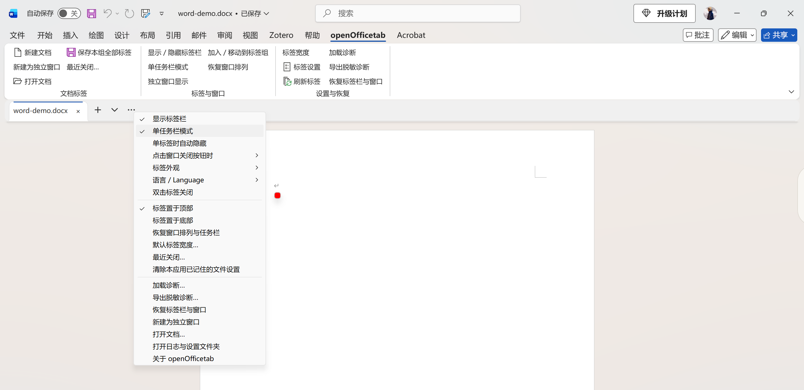
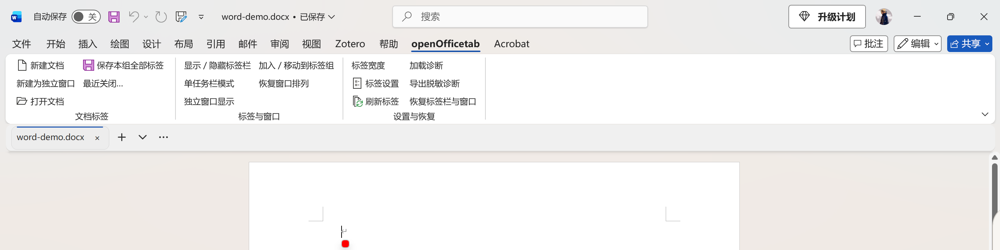
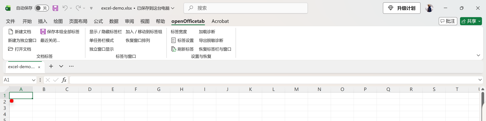
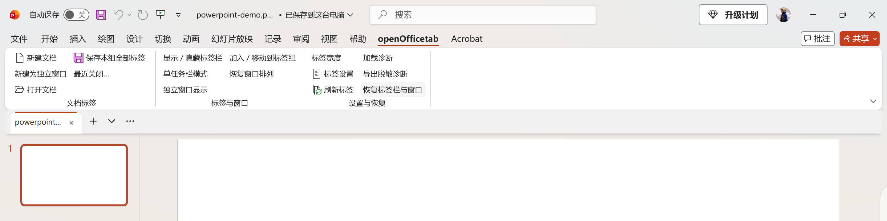
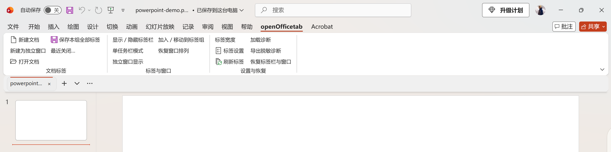

<div align="center">


# openOfficeTab

**让 Word、Excel、PowerPoint 像浏览器一样管理文档。**

免费 · 开源 · 原生 C++ · Windows 桌面 Office

[](LICENSE)
[](#兼容性)
[](https://github.com/xlennart/openOfficeTab/actions/workflows/build.yml)
[](https://github.com/xlennart/openOfficeTab/releases/latest)

[English](README.md) · **简体中文**

[下载安装](https://github.com/xlennart/openOfficeTab/releases/latest) · [使用指南](#使用指南) · [版本更新](#版本更新) · [反馈问题](https://github.com/xlennart/openOfficeTab/issues) · [开发说明](docs/development.md)

</div>

---

openOfficeTab 为桌面 Office 的功能区下方增加一条文档标签栏：点击切换、拖动排序、右键管理，并能将某个文档移出标签组，继续用独立窗口编辑。它保留 Office 原有文档对象和保存提示，不需要把文件转换成其他格式。

当前版本为 **0.2.2**：统一安装器在 64 位 Windows 下自动匹配 32/64 位 Office，新增独立更新窗口，修复前台标签选择和跨位数加载诊断，保留共享中英文设置与脱敏日志。实际覆盖范围及限制见 [验证记录](docs/validation-v0.2.2.md)。

原生标签栏、菜单支持中英文。安装器和管理中心支持中英文，在侧栏底部或安装内容区选择语言，与原生插件共享设置，默认跟随 Windows 显示语言。

下载：[GitHub Releases](https://github.com/xlennart/openOfficeTab/releases/latest) · [CNB 国内镜像](https://cnb.cool/xlennart/openofficetab/-/releases)。两端提供相同安装包和校验文件。

安装器与管理中心仍为 x64，同一安装包包含两种 Office 插件。见 [架构与测试说明](docs/office-x86.md)。

32 位 Office 在 VMware 虚拟机中测试：Windows 11 企业版 LTSC 26100（64 位），Microsoft 365 Apps 16.0.20527.20112（32 位）。此环境不覆盖所有 Office 版本。如遇问题，请按[故障报告模板](https://github.com/xlennart/openOfficeTab/issues/new?template=bug_report.yml)提供复现步骤、Office 版本与位数，附上导出的脱敏诊断日志，必要时附视频。

## 看看效果

以下截图展示中文 Office 与 openOfficeTab 的空白示例文件，同时提供**融合式开口标签**与**独立圆角面板**两种外观。展开各应用下方的对比，即可查看另一种样式。

### Word · 蓝色强调

融合式开口标签、插件功能区与中文设置菜单：



<details>
<summary>外观对比：Word 独立圆角面板</summary>



</details>

### Excel · 绿色强调

融合式开口标签，采用绿色强调色：



<details>
<summary>外观对比：Excel 独立圆角面板</summary>


</details>

### PowerPoint · 橙红色强调

融合式开口标签，采用橙红色强调色：



<details>
<summary>外观对比：PowerPoint 独立圆角面板</summary>



</details>

以上截图由使用者提供，展示 0.1.7 版本。通过 **… → 标签外观** 可以切换两种样式；浅色融合模式的默认底色为 `#F0F0F0`。[英文 README](README.md#screenshots) 提供对应的英文界面截图。

## 管理中心与问题反馈

从 **openOfficeTab → 设置与恢复 → 管理中心** 进入；也可使用开始菜单中的 openOfficeTab 管理中心。概览查看组件状态，“外观与交互”调整标签，“诊断与修复”检查或修复注册，“关于与更新”检查新版。

点击“检查更新”时自动探测并选择可用线路，无需手动挑选镜像。更新元数据经过签名验证，安装包核对 SHA-256；自动下载和自动安装需要主动开启，安装等待 Office 退出，不代替你关闭文档。

从 0.2.2 起，“检查更新”会打开独立窗口，展示新版本和更新说明，或提示“当前已是最新版”。点击“立即更新”后下载、校验并安装。保存文档与保留设置的提示直接显示；Office 运行时，保持更新窗口打开并退出 Office 后继续。

若再次遇到标签、内容或窗口异常，请在 **诊断与修复 → 导出诊断与日志** 导出 JSON，在原 issue 下说明触发步骤和发生时间并附上文件。结构化时间线记录操作、Office 事件、窗口/标签编号及错误码，默认不采集文档名称、路径、正文、单元格、账号或令牌，不自动上传。日志有轮转与容量限制，详见 [诊断日志说明](docs/diagnostic-logging.md)。相关问题先保持打开，继续收集使用反馈。

## 它能做什么

| 功能 | 操作与行为 |
| :--- | :--- |
| 文档标签 | 点击切换；未保存状态显示 `*`；拖动调整顺序 |
| 新建与列表 | 标签后的 `+` 新建，向下箭头列出文档，`…` 打开设置 |
| 快速关闭 | 点击 `×` 或中键；可设置双击关闭；最后文档关闭后退出应用，取消关闭则继续编辑 |
| 右键管理 | 保存、另存为、关闭其他 / 左侧 / 右侧 / 全部标签、打开所在文件夹 |
| 独立窗口 | 右键“在独立窗口中显示”；原窗口、原文件和未保存编辑保留 |
| 多个标签组 | 拖出形成新标签组窗口，拖到另一个标签栏合并；也可通过菜单选择目标组 |
| 标签宽度 | 拖动标签右边缘单独调宽（80–360 DIP）；按文件记住；默认规则支持固定、按标题或压缩 |
| 最近关闭 | 从功能区或菜单重开最近 20 个已保存文件；已打开的文件直接切换；可清空记录 |
| 文件偏好 | 记住文件的手动宽度和独立窗口选择，跨重启保留；提供重置入口 |
| 界面语言 | 中英文界面，默认按 Windows 显示语言自动选择，也可手动指定；跨重启保留 |
| 设置同步 | 语言、单任务栏、明暗主题、关闭偏好、外观、颜色与默认宽度同步到已打开的 Office 实例 |
| 管理中心 | 整合组件安装、外观设置、诊断修复与更新；从功能区直接进入管理页 |
| 诊断与日志 | 导出脱敏操作时间线作为 issue 附件；恢复标签栏与窗口，保留文档编辑 |
| 更新 | 自动探测可用线路、验证发布签名和安装包哈希；保留设置，等待 Office 退出 |
| 防误关 | 锁定标签，避免从标签栏误关闭 |
| 窗口协调 | 同组切换沿用当前窗口的尺寸和位置，适配分屏；独立窗口和其他组不跟随。单任务栏模式可选；0.1.6 对新配置默认开启，保留已有明确选择 |
| 外观设置 | 浅灰融合开口标签 / 独立白色圆角面板；强调线顶部 / 底部 / 无；按应用配色，跟随 Office / 系统明暗主题 |

保存全部标签与批量关闭只处理当前标签组中的文档，会排除独立窗口和其他标签组。有其他独立文档、隐藏工作簿或受保护视图时，关闭最后一个可见标签不会替你退出应用。

## 安装

1. 从 [Releases](https://github.com/xlennart/openOfficeTab/releases/latest) 下载 `openOfficetab-0.2.2-setup-x64.exe`。
2. 保存文档并退出 Word、Excel、PowerPoint。
3. 双击安装程序，在安装页选择组件后点击 **安装**。
4. 重新打开 Office 文档，标签栏会出现在功能区下方。

安装按当前 Windows 用户注册，无需管理员权限。安装程序不会替你关闭 Office 窗口。

也可下载 `openOfficetab-0.2.2-win-x64.zip`，完整解压后运行 `Install.cmd`。ZIP 包与 EXE 安装相同的插件；源码可从仓库获取。

Release 附有 `SHA256SUMS.txt`。安装程序尚未做代码签名，可先核对文件校验值，或自行从源码构建。

```powershell
Get-FileHash .\openOfficetab-0.2.2-setup-x64.exe -Algorithm SHA256
```

### 卸载

保存文档并退出三款 Office，进入管理中心“诊断与修复”，点击 **卸载**；或从解压包运行 `Uninstall.cmd`。默认保留设置和日志。

需要一并清除设置时，可在 ZIP 解压目录执行：

```powershell
powershell -NoProfile -File .\scripts\uninstall.ps1 -RemoveSettings
```

## 使用指南

### 界面语言

在 **… → 语言 / Language** 中选择 **跟随系统（默认） / 简体中文 / English**。自动模式根据 Windows 显示语言选择：中文用简体中文，其他语言用英文。选择会跨重启保存，并同步到已打开的 Office 实例；刷新功能区、菜单和后续打开的插件对话框，不重建文档窗格。文件名、路径和正文不翻译；Office 保存提示和 Windows 原生窗口沿用各自语言。管理中心目前使用简体中文，不改变原生插件语言。

### 让一个文档使用独立窗口

右键该文档的标签，选择 **在独立窗口中显示**。该窗口会隐藏标签栏、退出窗口跟随，并恢复独立任务栏入口；文档不会被关闭或重新打开。

想恢复标签时，在该窗口的 **openOfficeTab** 功能区点击 **加入 / 移动到标签组**，选择目标组。功能区和标签菜单也提供 **新建为独立窗口**。

已保存的本地文件会记住独立窗口选择，重新打开后继续使用独立窗口。新文档在首次保存前只在内存中保留选择。若同一文件有多个编辑窗口，本次移出的是所选窗口，最后一次主动调整会成为下次打开该文件的默认选择。标签组成员关系仍只保留在本次会话。

### 拆分与合并标签组

把标签拖到标签栏外，可形成保留标签栏的新窗口；把它拖到另一窗口的标签栏，可加入该组。右键 **移到新标签组窗口** 或 **移动到标签组…** 也可完成同样的操作。纯独立窗口隐藏标签栏，需要用功能区加回。

分组只在同一款 Office 的同一应用实例内生效，目前不跨进程迁移，也不在重启后保存组成员。

### 调节标签宽度

把鼠标移到标签的右边缘，出现横向调整指针后左右拖动，即可单独调整该标签的宽度。拖动边缘不切换或关闭文档，也不会移动标签组；按 Esc 取消本次调整。已保存文件的手动宽度存入本机用户配置，关闭重开后恢复，不修改文档内容。未保存的新文档在首次保存后继承当前宽度。

“默认标签宽度…”只影响没有单独调整过的标签。右键标签 → **重置此文件的标签设置** 可清除该文件的手动宽度和独立窗口偏好；`…` → **清除本应用已记住的文件设置** 可清除当前应用的所有文件偏好，并恢复当前标签的默认宽度，已经独立的窗口保持当前位置，重新打开时按默认方式加入标签组。另存为的新路径会继承当前设置。

### 重开最近关闭的文件

点击功能区的 **最近关闭…**，或右键标签 / 点击 `…` → **最近关闭…**。每款应用保留最近 20 个确认关闭的已保存本地文件（含可访问的 UNC 路径）。取消关闭、仍然打开的隐藏文档或同一文件的其他编辑视图不会作为关闭记录。文件已打开时直接激活现有标签，文件移动或删除时保留记录并提示。未保存的新文档请使用 Office 自身的文档恢复。

菜单提供 **清空最近关闭记录**。该列表是文件路径历史，不包含正文或未保存内容，也不代替备份。

### 分屏时切换文档

把 Office 窗口放到屏幕一侧后，从这个窗口的标签栏切换文档，目标文档沿用当前窗口的实际位置和尺寸，不再沿用另一个文件的最大化状态。0.1.6 启用单任务栏时，同组的移动、调大小、最大化、还原、最小化也会同步；移出的独立窗口和其他标签组保留各自布局。底层保留 Office 原有文档窗口，不重挂或重新打开文档。

拖动窗口或边缘调整大小时，先临时遮蔽同组后台窗口，保持 Office 文档的可见状态；松开或取消后先同步最终位置和尺寸，再恢复后台窗口外观。独立窗口和其他组不参与遮蔽。尺寸通知合并处理，不在 Office 的布局回调中调整其他窗口，避免持续拖动时反复刷新或布局重入。

“恢复窗口排列”可以恢复插件调整前的布局；如果你之后手动改变过某个窗口的布局，恢复会保留这次手动调整。

0.1.6 的 **单任务栏模式** 会保存到用户配置，并在正在运行的 Office 实例之间同步；明确关闭后也会记住关闭状态。每个标签组保留当前文档的任务栏入口，独立窗口保留独立入口。隐藏标签栏时恢复其他入口，避免文档无法访问。恢复窗口排列或修复标签栏不会再关闭此设置。该模式协调当前进程内的文档，不合并不同 Office 进程，也不改变 Windows 的 Alt+Tab 列表。

### 点击窗口右上角关闭

0.1.6 启用单任务栏后，多标签时点击右上角 ×（或 Alt+F4）会询问 **关闭当前** / **关闭本组全部** / **取消**，并可勾选 **记住我的选择**。在“标签设置 → 点击窗口关闭按钮时”可重新选择“每次询问”。关闭全部只处理当前标签组，独立窗口和其他组不变；Office 原生保存提示保留，取消保存立即停止余下关闭。组内最后一份文档关闭且没有其他文档或受保护视图时退出应用。标签自身的 × 仍只关闭该标签。

### 选择外观

点击标签后的 `…` → **标签外观**，可以独立选择：

- **融入应用背景**：默认浅灰 `#F0F0F0`，去掉白色面板和面板阴影；外框保留与功能区一致的 8 DIP 两侧留边和圆角；在确认过的顶部功能区底缘补齐背景色，减轻原生阴影造成的接缝；选中标签为白色，朝文档内容区开口。放到底部时，开口也朝内容区。
- **独立标签栏**：保留白色圆角面板和封闭的灰色选中标签。
- **强调线**：顶部、底部、无。Word 为蓝色，Excel 为绿色，PowerPoint 为橙红色。

默认使用浅灰融合样式和顶部强调线。这些外观选择会保存到当前用户设置；已运行的其他 Office 实例通常在一秒内同步外观、颜色和默认宽度；模态对话框或应用忙时延后。切换外观只重绘插件控件，不重建 Office 窗格。0.1.5 的深色需要手动选择；0.1.6 默认跟随 Office 主题；Office 选择“使用系统设置”时跟随 Windows。也可在“标签外观 → 明暗主题”选择始终浅色、始终深色或仅跟随系统。黑色主题的融合主体和顶部接缝为 `#262626`，深灰 Office 主题使用相应深灰；深色融合样式使用与深色功能区相近的齐边布局，保留底部分隔线。

在 **… → 标签外观 → 标签栏颜色…** 输入 `#RRGGBB` 或用调色板选择颜色；自定义底色也可用于独立面板。点击 **恢复默认颜色**，融合样式恢复 `#F0F0F0`，独立面板恢复白色。取消对话框不改变设置；深色模式和系统高对比度优先于自定义颜色。

### 统一宽度规则

在 **… → 默认标签宽度…** 或功能区的 **标签宽度** 中设置 80–360。数值按显示缩放适配；标题长度与压缩模式将该数值作为上限。取消对话框不改变设置。

### 诊断和恢复

功能区提供 **加载诊断**、**导出脱敏诊断**、**恢复标签栏与窗口**。恢复会重建插件自己的标签栏、显示标签并关闭单标签自动隐藏，保留文件、编辑、组成员和顺序。0.1.6 同时保留单任务栏选择（0.1.5 的恢复命令会关闭它）。

插件完全没有加载时，打开管理中心 **诊断与修复** 查看注册状态；保存并退出 Office 后再点 **修复**。诊断导出不包含文件名、路径、正文、账号或原始日志，修复不修改 Office 安全策略。

### 找到设置和恢复入口

点击标签后的 **…**，或在 **openOfficeTab** 功能区打开 **标签设置**。功能区也提供显隐、刷新、窗口跟随和恢复入口。

标签锁定只防止从标签栏误关，不改变文件权限；标题栏明确选择关闭本组时仍交给 Office 正常关闭并询问保存。

## 兼容性

### 开发环境

当前开发电脑使用以下环境（核对日期：2026 年 10 月 30 日）：

| 组件 | 版本 |
| :--- | :--- |
| 操作系统 | Windows 11 企业版 26H2，64 位；系统内部版本 **26300.9711** |
| Office | Microsoft Office 桌面版，即点即用（Click-to-Run），**64 位**；版本 **16.0.20527.20088** |
| 宿主应用 | 上述 Office 安装中的 Word、Excel、PowerPoint |

以上版本用于说明开发环境，不代表最低要求，也不表示已验证所有 Office 版本。下方早期运行测试记录使用的是 Office **16.0.20430.20146**，此后开发电脑上的 Office 已更新。

### 兼容与验证范围

| 项目 | 当前状态 |
| :--- | :--- |
| 早期实机验证环境 | Windows 11、Office Home 2024 x64、Word / Excel / PowerPoint 16.0.20430.20146 |
| 已验证缩放 | 200% 缩放；水平栏被本机 Office 限制为至少 80 物理像素，约 40 DIP |
| 发布架构 | 0.2.2：64 位 Windows 下自动匹配 x86/x64 Office，同一安装包包含两种原生载荷 |
| x86 / 其他 Office 版本 | 32 位 Office 在 VMware 中测试，版本 16.0.20527.20112；64 位在宿主机测试，版本 16.0.20527.20088；其他版本未全部覆盖 |
| Office 网页版 / macOS | 不支持；这是 Windows 原生 COM 加载项 |

目前是可使用的早期版本，不承诺覆盖成熟商用标签插件的全部功能。尚未提供全局快捷键和完整辅助技术语义。验证方法与边界见 [验证记录](docs/validation.md)。

## 常见问题

**双击文件却没有标签栏？**

先保存并退出 Office，重新安装后再打开文档；然后在 COM 加载项列表检查 `openOfficetab` 是否加载。若插件已加载，可从功能区检查显隐及“单标签时自动隐藏”设置。Office 安全模式、受保护视图或组织策略可能限制加载项；请在普通编辑窗口核对，不需要修改 Office 安全设置。

从 Codex 开发环境执行安装时，脚本会交给独立桌面进程完成注册，避免开发环境中的注册表与 AppData 隔离造成安装只对测试窗口生效。

**配置和日志存在哪里？**

位于 `%LOCALAPPDATA%\openOfficetab`。`settings.ini` 保存全局设置；`documents.ini` 保存按应用区分的文件偏好和最近关闭路径。路径仅作格式编码，不是加密；这些文件留在本机，不会上传，脱敏诊断也不会包含路径历史。发生问题后建议使用管理中心的“导出诊断与日志”，将生成的 JSON 作为 issue 附件；不要直接上传设置文件或旧版原始日志。

**修改设置后其他窗口没变化？**

外观、颜色、默认宽度通常在一秒内同步；忙碌或原生对话框期间稍后应用。文件的手动宽度优先于默认宽度。单任务栏、明暗主题和标题栏关闭偏好会同步；显隐、停靠位置不做运行中联动；安装新版 DLL 仍需保存并重开应用。

## 版本更新

| 版本 | 日期 | 主要更新 |
| :--- | :--- | :--- |
| [0.2.2](https://github.com/xlennart/openOfficeTab/releases/tag/v0.2.2) | 2026-10-30 | 统一 x86/x64 Office 安装器、独立更新窗口、加载诊断及标签选择修复。 |
| [0.2.1](https://github.com/xlennart/openOfficeTab/releases/tag/v0.2.1) | 2026-10-29 | 安装器与管理中心中英双语，共享语言偏好，修正小窗口布局和英文说明控件名称。 |
| [0.2.0](https://github.com/xlennart/openOfficeTab/releases/tag/v0.2.0) | 2026-10-28 | 管理中心、脱敏日志导出与自动选线更新；标签与文档内容同步的初步修复；统一功能区布局。 |
| [0.1.9](https://github.com/xlennart/openOfficeTab/releases/tag/v0.1.9) | 2026-10-23 | 修复 Excel 输入公式时通过标签选取其他工作簿单元格引用；编辑期间延后窗口协调，保留原生公式输入流程。 |
| [0.1.8](https://github.com/xlennart/openOfficeTab/releases/tag/v0.1.8) | 2026-10-19 | 新建原生命令排队；等待功能区内容归位后创建窗格、协调窗口；增加实际功能区内容回归检查。 |
| [0.1.7](https://github.com/xlennart/openOfficeTab/releases/tag/v0.1.7) | 2026-10-18 | 完整中英文界面；可保存的语言设置，自动跟随 Windows 显示语言；功能区实时翻译；双语安装器和安装说明。 |
| [0.1.6](https://github.com/xlennart/openOfficeTab/releases/tag/v0.1.6) | 2026-10-17 | 单任务栏设置跨重启保留，新配置默认开启；跟随 Office / 系统主题；同组窗口操作同步与关闭选择；修复调整尺寸及 PowerPoint 激活问题。 |
| [0.1.5](https://github.com/xlennart/openOfficeTab/releases/tag/v0.1.5) | 2026-10-15 | 最近关闭重开；按文件记住宽度和独立窗口；外观设置实时同步；功能区接缝修整。 |
| [0.1.4](https://github.com/xlennart/openOfficeTab/releases/tag/v0.1.4) | 2026-10-13 | 三款应用分屏切换跟随；功能区界面所有权修复；自定义标签栏颜色，默认 `#F0F0F0`。 |
| [0.1.3](https://github.com/xlennart/openOfficeTab/releases/tag/v0.1.3) | 2026-10-11 | 融合开口标签；强调线顶部 / 底部 / 无；拖动标签边缘单独调宽。 |
| [0.1.2](https://github.com/xlennart/openOfficeTab/releases/tag/v0.1.2) | 2026-10-11 | 关闭最后文档后退出；完整独立窗口流程；多个标签组；宽度策略；诊断与恢复。 |
| [0.1.1](https://github.com/xlennart/openOfficeTab/releases/tag/v0.1.1) | 2026-10-10 | 首次公开发布：Word、Excel、PowerPoint 原生文档标签、文档管理及 x64 EXE / ZIP 安装包。 |

日期沿用项目发布记录，按北京时间（UTC+8）列出。完整更新见 [CHANGELOG.md](CHANGELOG.md)；安装包与各版发布说明见 [Releases](https://github.com/xlennart/openOfficeTab/releases)。

## 开发与参与

安装 Visual Studio Build Tools 的 C++ 工具和 Windows SDK 后：

```powershell
pwsh -File .\scripts\build.ps1 -Architecture x64
pwsh -File .\scripts\build.ps1 -Architecture x86
pwsh -File .\scripts\package.ps1
```

原生构建产生 `dist/x64/openOfficetab.dll` 与 `dist/x86/openOfficetab.dll`；`scripts/build-desktop.ps1` 使用 Node.js、Rust/MSVC 构建 Tauri 管理中心及 Windows .NET Framework 本地服务。管理中心使用 WebView2，Office 内的标签栏仍为原生 C++。打包产生 EXE、ZIP、校验文件和签名更新元数据。GitHub Actions 会编译并校验安装包；Office 的实际运行测试需要本机安装桌面 Office。

源码、测试与发布流程见 [开发说明](docs/development.md)；与 Office Tab 的差别及建议见 [功能对比与开发优先级](docs/comparison.md)。欢迎通过 Issues 提交可复现的问题或功能建议；请注明 Windows、Office 版本、位数及缩放比例。

## 许可证

[MIT](LICENSE)。openOfficeTab 独立实现，不包含对标软件的源码或二进制，与 Microsoft、ExtendOffice 等厂商无隶属关系。Office 及其他产品名称归各自权利人所有。
