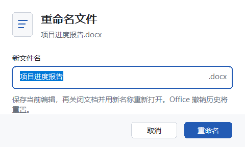
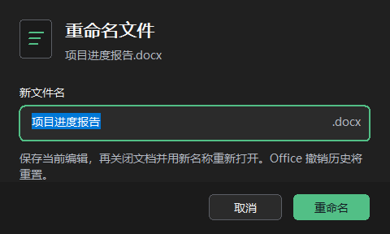

# 标签页右键重命名验证

## 使用

标签上右键 → **重命名文件…** → 输入不含扩展名的新名称 → **重命名**。Office 先按原格式保存当前编辑，再关闭文档。Windows 在原目录内原子重命名，随后 Office 从新路径重新打开。取消重命名对话框不会保存或改动文件。遇到同名目标时保留两个文件，已保存的编辑仍在原路径。文件已重命名但 Office 无法重开时，请从新路径手动打开。

适用于已保存、可写的文件。多窗口文档、URL 文档、仅大小写变化，以及无法可靠识别格式的 PowerPoint .pptx 文件会被拒绝。重开文档会重置 Office 的撤销历史。指向旧路径的外部链接需要在相应文档中更新。

## 自动测试

- 文件名测试覆盖扩展名、保留名称、长度、目录穿越及 UNC 路径。
- 会话测试使用模拟 Office COM、Windows 文件和 OPC 包，覆盖普通和 Strict .pptx、损坏包和格式标记不一致、保存或关闭取消、目标在保存及关闭期间才出现、原路径被替换、重开失败及偏好继承。
- 两种架构的入口为 `pwsh -File scripts/test-native.ps1 -Architecture x64` 和 `pwsh -File scripts/test-native.ps1 -Architecture x86`。

## Office 实机验收清单

使用可丢弃的示例，记录 Office 应用、构建号、位数、测试提交和 DLL 哈希。退出 Office 后核对文件和保存的内容。

1. 编辑 Word、Excel 和 PowerPoint 示例后，从前台窗口的标签右键菜单重命名。观察关闭到重开期间是否露出桌面或空白窗口，核对新路径、内容、格式、标签及其偏好。分别测试最大化窗口和普通窗口，以及关闭或重开时 Office 弹出提示的场景。
2. 分别使用普通和 Strict .pptx，核对重命名前后主部件的命名空间。测试宏演示文稿、模板及放映格式。
3. 测试取消、保存失败、关闭被取消、目标已存在，以及在 Office 保存或关闭期间才创建同名目标。核对原文件与冲突文件均保留。
4. 测试无法识别的 .pptx、多窗口文档、未保存或只读文档、Office 忙、仅大小写变化，以及文件成功改名后重开失败。
5. 检查中文和英文、键盘、缩放、高对比度、网络共享及重开后的分组、宽度、锁定状态和最近关闭记录。

## 原生弹窗预览

`src/rename-dialog.h` 使用原生 EDIT / BUTTON / STATIC 控件，提供浅色、深色、应用强调色及中英文界面。扩展名单独显示，不进入编辑框；输入初始选中文件名。字号和布局跟随 DPI，按钮保留焦点提示，并使用系统高对比度配色。

```powershell
pwsh -NoProfile -File scripts/preview-rename-dialog.ps1
```

此脚本编译当前 x64 源码，并运行 `tests/rename-dialog-preview.cpp`：将测试弹窗放到屏幕外且不激活，导出浅色中文、深色中文和英文预览，检查控件边界、编辑长度和默认按钮绘制。它不会启动 Office，也不会操作用户文档。输出位于忽略的 `artifacts/`。





活动选择测试在重置默认设置时保留测试存储目录，避免刷新从真实用户配置加载强调线等外观偏好。此问题已在未修改的上游代码中复现，修正仅隔离测试配置，不更改插件行为。
